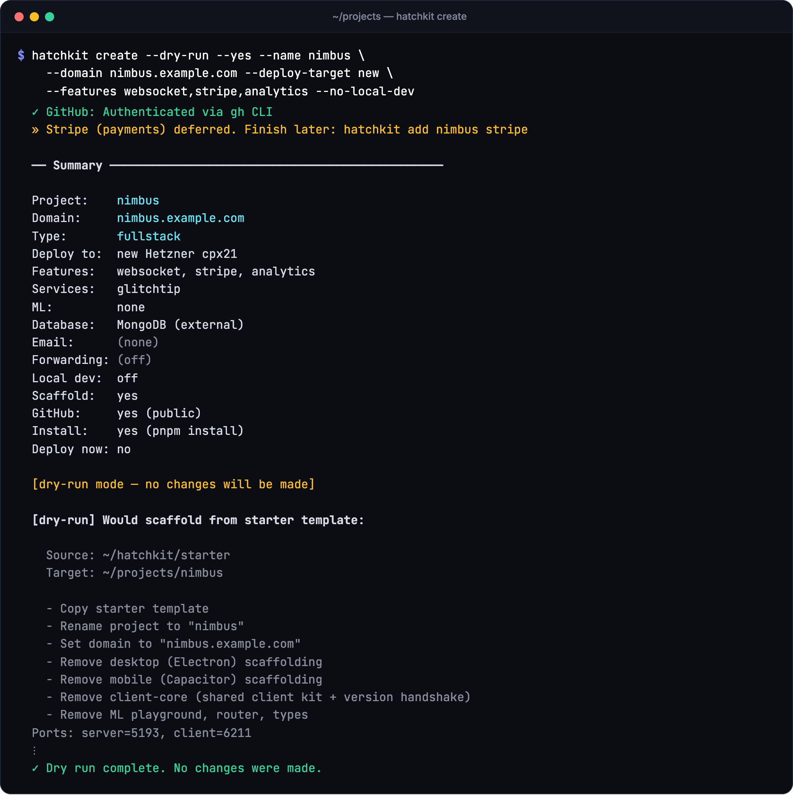
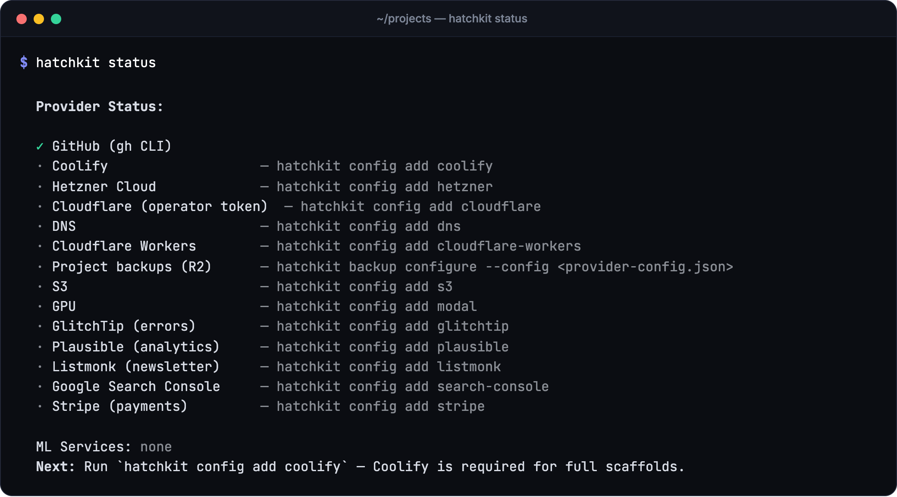

# hatchkit

> Start a TypeScript app on a server you own, without redoing the setup for every project.

[](https://www.npmjs.com/package/hatchkit)
[](https://github.com/trebeljahr/hatchkit/actions/workflows/ci.yml)
[](LICENSE)

Every new product needs the same groundwork before its first feature. You create a GitHub repo, DNS records, a server and a deploy pipeline, then wire up error tracking, analytics, email and encrypted secrets. By hand, that means another round through each provider's dashboard for every project, and no two projects end up wired the same way.

Hatchkit does that setup from the terminal. Run `hatchkit setup` once, and it stores your provider tokens in the OS keychain. Then `hatchkit create` asks for a name, a domain, the features you want and a deploy target. It scaffolds the app, creates the GitHub repo, writes the DNS records and deploys to Coolify. The server can be a new Hetzner box or one you already run.

The same CLI looks after the project afterwards. `hatchkit doctor` checks every provider with read-only calls and prints the fix for each failure. `hatchkit sync` brings domains, env and deploy secrets back in line with the project manifest, and `hatchkit backup` configures snapshots and tests restores. Everything it creates lives in your own accounts. There is no hosted hatchkit service.

**Docs:** [hatchkit.trebeljahr.com](https://hatchkit.trebeljahr.com/) · **npm:** [`hatchkit`](https://www.npmjs.com/package/hatchkit)

<p align="center">
  
</p>

---

## What it sets up

- **The app.** A TypeScript monorepo from [`starter/`](starter/): a Next.js client, an Express + tRPC server and Better Auth. Pick features at create time (websockets, Stripe, analytics, S3, Electron desktop, Capacitor mobile, i18n, an MCP server and more). `hatchkit create --help` lists all 18, and `hatchkit update` adds some of them later.
- **Hosting.** DNS records on Cloudflare, a Hetzner server through Terraform, and a Coolify app with rolling Docker image deploys. Static sites can go to GitHub Pages or Cloudflare Workers instead. You can also deploy to a Coolify server you already run.
- **Services.** GlitchTip error tracking, Plausible analytics, Listmonk with Amazon SES for email, Cloudflare Email Routing and Google Search Console, with separate dev and prod clients per project.
- **Secrets.** Env files are encrypted with dotenvx. The private keys stay in the OS keychain and on your deploy targets, never in git.
- **ML services.** Eight GPU service templates in [`services/ml/`](services/ml/). Deploys to Modal are automated. RunPod, Hugging Face and Replicate selections print the manual steps. Review the endpoint values before you use them.
- **Undo.** `create` and `adopt` keep a ledger, so `hatchkit destroy <project>` can roll back what they made. `--recipe` prints the rollback commands without running them.

Hatchkit is a tool for one developer and their own accounts. It expects DNS on Cloudflare, and Coolify for any app with a server.

---

## Quickstart

```bash
# One-time: wire up credentials (GitHub, Coolify, Hetzner, DNS, …)
npx hatchkit setup

# See what's configured and what's next
npx hatchkit status

# Scaffold + deploy a new project
npx hatchkit create
```

You need Node.js 22 or newer, git and the GitHub CLI signed in (`gh auth login`). [Getting Started](https://hatchkit.trebeljahr.com/docs/getting-started) lists the provider accounts each deploy target needs.

`create` walks you through name → domain → features → ML → deploy target. Then it scaffolds the app, commits it, creates the GitHub repo, provisions DNS and the server, and deploys the app to Coolify.

Every one of those questions also has a flag. Pass the answers you already know and only the rest get prompted, or add `--yes` to skip prompting entirely:

```bash
hatchkit create --yes --name blog --domain blog.example.com \
  --surfaces fullstack --deployment-mode coolify --features analytics --public
```

Run `hatchkit create --help` for the full flag list, or see the [commands reference](https://hatchkit.trebeljahr.com/docs/commands#hatchkit-create).

New to the CLI? Run `hatchkit explain` for concepts, command families, and common workflows.

On a new machine, `hatchkit status` shows which providers are still missing and the next command to run:

<p align="center">
  
</p>

---

## Commands at a glance

| Command | What it does |
|---|---|
| `hatchkit setup` | One-time onboarding — stores tokens in the OS keychain. Alias: `init`. |
| `hatchkit status` | Show which providers are configured and what's the next best step. |
| `hatchkit doctor` | Health-check every configured provider with a read-only API call + contextual fix hints on failures. |
| `hatchkit explain` | Print the one-page mental model (concepts, commands, workflow). |
| `hatchkit create` | Scaffold a new project and optionally deploy it end-to-end. Interactive by default; every prompt has a matching flag, and `--yes` makes it fully non-interactive. |
| `hatchkit update` | Add features (workspaces, desktop, mobile, …) to a project already scaffolded. |
| `hatchkit add <project> [services]` | Provision GlitchTip / Plausible / Listmonk + SES / email / search clients for an existing project. |
| `hatchkit signing org-init` | One-time per dev machine — collect Apple Distribution .p12 / App Store Connect API key, Google Play service account JSON, Azure Trusted Signing service principal. |
| `hatchkit signing apply [project-dir]` | Wire signed installers and store uploads for the Windows, iOS and Android builds. Idempotent. See [Signing](docs/content/docs/signing.mdx) for every file and secret it writes. |
| `hatchkit mac-runner on\|off\|serve\|run\|status` | Run a private repo's macOS and iOS jobs on this Mac, on demand, instead of GitHub's macOS runners. `on` sets the repo variable `APPLE_RUNNER`; `serve` hosts the queued jobs with a just-in-time runner and deregisters it after the runs finish. Artifacts, store uploads and draft releases stay in the same workflow. |
| `hatchkit gh-pages` | Wire GitHub Pages for the current repo (static / Vite / Jekyll) with optional custom domain + DNS. |
| `hatchkit cloudflare` | Wire Cloudflare Workers Static Assets for the current repo — free, unmetered asset requests. |
| `hatchkit keys show/push <project>` | Read or push the dotenvx private key to Coolify. |
| `hatchkit sync` | Reconcile apps, routing, env, DNS and deploy secrets with the project manifest. |
| `hatchkit backup` | Configure backups, inspect snapshots and test isolated recovery. |
| `hatchkit destroy <project>` | Roll back what `hatchkit create` made, from its ledger. `--recipe` only prints the commands. |
| `hatchkit config [add/reset]` | Inspect or modify stored provider credentials. |
| `hatchkit completion <shell>` | Print a zsh / bash / fish completion script. |

Full reference: **[Commands](https://hatchkit.trebeljahr.com/docs/commands)**, or `hatchkit help <command>`.

---

## How the pieces fit

```
           ┌──────────────────────────────────────────────┐
           │              hatchkit create                  │
           └──────────────────────────────────────────────┘
                                │
        ┌───────────────────────┼────────────────────────┐
        ▼                       ▼                        ▼
 ┌─────────────┐         ┌─────────────┐          ┌─────────────┐
 │  Scaffold   │         │   Infra     │          │     ML      │
 │             │         │             │          │             │
 │  starter →  │         │ Terraform → │          │  Modal      │
 │  your repo  │         │ DNS + VPS   │          │  templates  │
 │  + GitHub   │         │ + Coolify   │          │  + manual   │
 └─────────────┘         └─────────────┘          └─────────────┘
        │                       │                        │
        └───────────────────────┼────────────────────────┘
                                ▼
                     https://your-domain.example
```

See **[Architecture](https://hatchkit.trebeljahr.com/docs/architecture)** for the deeper tour.

---

## For agents

Agents (Claude Code, Cursor, Claude Desktop) can drive hatchkit without scraping CLI output:

- `hatchkit status --json` → `StatusSnapshot` (providers, `nextStep`, suggested commands).
- `hatchkit doctor --json` → per-provider health with a `hint[]` array on failing checks (credential rotation URL, required scopes, the exact `hatchkit config add <x>` to re-run).
- `hatchkit explain --json` → full mental model (concepts, commands, workflows, state locations).
- `hatchkit keys show <project> --json` → `{ project, found, key }`.

`SKILL.md` at the repo root (plus `.agents/skills/hatchkit/SKILL.md` and `.claude/skills/hatchkit/SKILL.md`) tells agents when and how to reach for hatchkit.

The optional `@hatchkit/mcp` package exposes local CLI status and doctor tools. The `mcp` project feature generates a separate server for one app's public API. See the [MCP guide](docs/content/docs/mcp.mdx) and [operator server README](mcp/README.md).

---

## Shell completion

```bash
hatchkit completion zsh  > ~/.zsh/completions/_hatchkit
hatchkit completion bash > /usr/local/etc/bash_completion.d/hatchkit
hatchkit completion fish > ~/.config/fish/completions/hatchkit.fish
```

---

## State — where things live

| What | Where |
|---|---|
| Provider metadata (no secrets) | `~/<conf-dir>/config.json` |
| Secrets (tokens, keys) | OS keychain, service `hatchkit` |
| Provisioned env blocks | `~/<conf-dir>/provisioned/<project>.{dev,prod}.env` |
| Project manifest | `<project>/.hatchkit.json` |

`HATCHKIT_CONF_DIR` overrides the config directory.

---

## Documentation

Full docs live under [`docs/`](docs/) and are published at [https://hatchkit.trebeljahr.com/](https://hatchkit.trebeljahr.com/).

- [Getting Started](https://hatchkit.trebeljahr.com/docs/getting-started) — install, onboard, create your first project
- [Commands reference](https://hatchkit.trebeljahr.com/docs/commands) — command families, examples, and options
- [Backups and recovery](https://hatchkit.trebeljahr.com/docs/backups) — registration, retention, alerts, and restore drills
- [Operations](https://hatchkit.trebeljahr.com/docs/operations) — host security checks, Cloudflare audit credentials, and generated operational files
- [Migrations](https://hatchkit.trebeljahr.com/docs/migrations) — runtime and client-host migration, rollback, and cleanup
- [Providers](https://hatchkit.trebeljahr.com/docs/providers) — GitHub, Coolify, Hetzner, DNS, S3, GPU platforms
- [ML services](https://hatchkit.trebeljahr.com/docs/ml-services) — deploy GPU-backed models the CLI understands
- [GitHub Pages](https://hatchkit.trebeljahr.com/docs/gh-pages) — `hatchkit gh-pages` for static sites, SPAs, Jekyll docs, and Docusaurus docs
- [Cloudflare Workers](https://hatchkit.trebeljahr.com/docs/cloudflare) — `hatchkit cloudflare` for static sites on Cloudflare
- [Architecture](https://hatchkit.trebeljahr.com/docs/architecture) — how scaffold / infra / deploy fit together
- [Deploying the docs site](https://hatchkit.trebeljahr.com/docs/deployment) — the deployment flow used by this repo

Source for those pages lives in [`docs/content/docs/`](docs/content/docs/).

---

## Community and support

- [Contributing](CONTRIBUTING.md) — local setup, validation, and PR expectations
- [Security](SECURITY.md) — how to report vulnerabilities or leaked secret issues privately
- [Support](SUPPORT.md) — where to ask questions and what diagnostics help
- [Code of Conduct](CODE_OF_CONDUCT.md) — project participation expectations
- [Changelog](CHANGELOG.md) — user-visible release notes

Hatchkit is free and MIT-licensed. If it saves you time, you can support its development at [ricos.site/donate](https://ricos.site/donate).

---

## Repo layout

```
hatchkit/
├─ cli/              # the npm package (published as `hatchkit`)
├─ mcp/              # @hatchkit/mcp — MCP server for agents
├─ packages/         # @hatchkit/dev-shared + Next.js and Vite dev plugins (local-dev URLs)
├─ starter/          # full-stack starter template (subtree-merged)
├─ infra/            # Terraform + Coolify automation (subtree-merged)
├─ services/ml/      # eight GPU service templates: subtitles, image recognition,
│                    #   background removal and five 3D extraction variants
├─ docs/             # Next.js/Fumadocs docs site — deployed to Cloudflare Workers
│  └─ marketing/     # README screenshots and social preview cards (see its README)
├─ scripts/          # docs release helpers + marketing capture scripts
└─ .github/workflows/
   ├─ ci.yml         # typecheck + lint + scaffold matrix
   ├─ gitleaks.yml   # secret scanning
   └─ deploy.yml     # docs build + Cloudflare Worker deploy
```

---

## Development

```bash
# Install deps (monorepo)
pnpm install

# Run the CLI against the local source (tsx)
pnpm --filter hatchkit dev

# Typecheck + lint + scaffold test matrix
pnpm --filter hatchkit check

# Install locally as a global command
pnpm --filter hatchkit install-local
```

Clone the repo and you're set — `starter/` and `infra/` are in-tree
(previously git submodules; merged via `git subtree`).

```bash
git clone https://github.com/trebeljahr/hatchkit.git
```

---

## Related tools

Hatchkit handles scaffolding, providers, infrastructure, and deployment. These sibling tools cover asset and naming work that often happens before or beside a Hatchkit project.

- [`conv3d`](https://github.com/trebeljahr/conv3d) — converts FBX, OBJ, and glTF assets to GLB and can emit typed React Three Fiber components for 3D, game, or asset-heavy starters.
- [Sprite Tools](https://github.com/trebeljahr/sprite-tools) — builds game-ready 2D sprite assets with collision polygons, pivots, animation tags, palettes, atlases, and exports.
- [`name-checker`](https://github.com/trebeljahr/name-checker) — checks candidate names across trademarks, domains, socials, app stores, package registries, and code hosts before launch setup.

---

## License

MIT, see [LICENSE](LICENSE). The ML templates wrap third-party models whose weights keep their own upstream licences. Each folder under [`services/ml/`](services/ml/) has a `MODEL_LICENSE.md` that names them.
